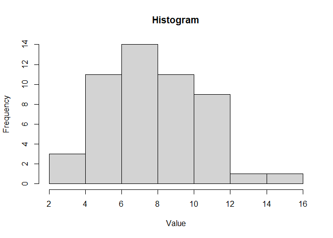
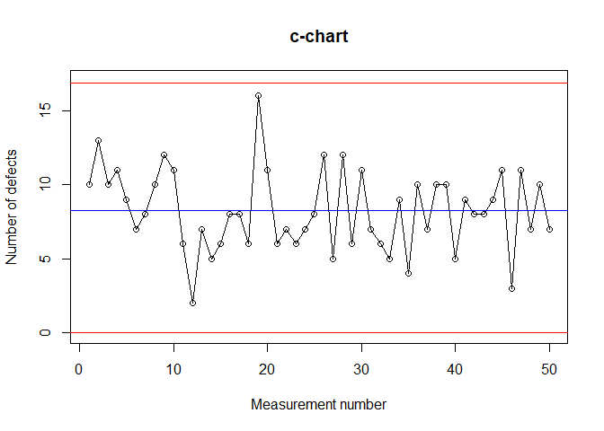

c-chart for statistical process control
================
Raul Almuzara

 

### **Introduction**

We will work with a dataset which simulates the data that could have
been collected from one variable of an industrial process. In this case,
we have a list of the number of defects detected in each manufactured
product, with each product representing the same inspection unit and
produced by a stable process. We will obtain a c-chart using the
appropriate statistical techniques. Then, we will judge if the
industrial process is under control or if there could be a problem.

 

### **Analysis**

We will use the file *datacc3.txt*.

``` r
data3 <- read.delim('datacc3.txt', header = FALSE)
colnames(data3) <- c('Value')
data3
```

    ##    Value
    ## 1     10
    ## 2     13
    ## 3     10
    ## 4     11
    ## 5      9
    ## 6      7
    ## 7      8
    ## 8     10
    ## 9     12
    ## 10    11
    ## 11     6
    ## 12     2
    ## 13     7
    ## 14     5
    ## 15     6
    ## 16     8
    ## 17     8
    ## 18     6
    ## 19    16
    ## 20    11
    ## 21     6
    ## 22     7
    ## 23     6
    ## 24     7
    ## 25     8
    ## 26    12
    ## 27     5
    ## 28    12
    ## 29     6
    ## 30    11
    ## 31     7
    ## 32     6
    ## 33     5
    ## 34     9
    ## 35     4
    ## 36    10
    ## 37     7
    ## 38    10
    ## 39    10
    ## 40     5
    ## 41     9
    ## 42     8
    ## 43     8
    ## 44     9
    ## 45    11
    ## 46     3
    ## 47    11
    ## 48     7
    ## 49    10
    ## 50     7

There are $k=50$ measurements.

``` r
k <- 50
```

Here is a histogram with all measurements.

``` r
hist(data3$Value, main = 'Histogram', xlab = 'Value', ylab = 'Frequency')
```

<!-- -->

If the data were to follow a Poisson distribution, the mean and variance
should be fairly similar.

``` r
cbar <- mean(data3$Value)
cbar
```

    ## [1] 8.24

``` r
var(data3$Value)
```

    ## [1] 7.533061

We carry out a goodness-of-fit test for the Poisson distribution. The
null hypothesis cannot be rejected and the data could be compatible with
a Poisson distribution.

``` r
library(vcd)
```

    ## Loading required package: grid

``` r
gof <- goodfit(data3$Value, type='poisson')
summary(gof)
```

    ## 
    ##   Goodness-of-fit test for poisson distribution
    ## 
    ##                       X^2 df  P(> X^2)
    ## Likelihood Ratio 10.18119 11 0.5141666

For the c-chart, we can treat each measurement as its own rational
subgroup.

``` r
defects <- data3$Value
```

The points in the c-chart are directly the number of defects found in
each measurement.

``` r
names(defects) <- paste('Subgroup', 1:k)
print(defects)
```

    ##  Subgroup 1  Subgroup 2  Subgroup 3  Subgroup 4  Subgroup 5  Subgroup 6 
    ##          10          13          10          11           9           7 
    ##  Subgroup 7  Subgroup 8  Subgroup 9 Subgroup 10 Subgroup 11 Subgroup 12 
    ##           8          10          12          11           6           2 
    ## Subgroup 13 Subgroup 14 Subgroup 15 Subgroup 16 Subgroup 17 Subgroup 18 
    ##           7           5           6           8           8           6 
    ## Subgroup 19 Subgroup 20 Subgroup 21 Subgroup 22 Subgroup 23 Subgroup 24 
    ##          16          11           6           7           6           7 
    ## Subgroup 25 Subgroup 26 Subgroup 27 Subgroup 28 Subgroup 29 Subgroup 30 
    ##           8          12           5          12           6          11 
    ## Subgroup 31 Subgroup 32 Subgroup 33 Subgroup 34 Subgroup 35 Subgroup 36 
    ##           7           6           5           9           4          10 
    ## Subgroup 37 Subgroup 38 Subgroup 39 Subgroup 40 Subgroup 41 Subgroup 42 
    ##           7          10          10           5           9           8 
    ## Subgroup 43 Subgroup 44 Subgroup 45 Subgroup 46 Subgroup 47 Subgroup 48 
    ##           8           9          11           3          11           7 
    ## Subgroup 49 Subgroup 50 
    ##          10           7

For the c-chart, the relevant lines are:

– The center line (blue):

$$CL = \overline{c} \\\approx 8.2400$$

– The lower control limit (red) (in this case, it is negative, so it is
not of much interest and we will just plot a line at 0):

$$LCL = \overline{c} - 3\sqrt{\overline{c}} \\\approx 8.2400 - 3\sqrt{8.2400} \\\approx -0.3716 \\<0$$

– The upper control limit (red):

$$UCL = \overline{c} + 3\sqrt{\overline{c}} \\\approx 8.2400 + 3\sqrt{8.2400} \\\approx 16.8516$$

With all the information above, we plot the c-chart.

``` r
plot(1:k, defects, type='o', main = 'c-chart', xlab = 'Measurement number', ylab = 'Number of defects', ylim = c(0, max(defects)+1))
abline(h=cbar, col='blue')
abline(h=max(0, cbar-3*sqrt(cbar)), col='red')
abline(h=cbar+3*sqrt(cbar), col='red')
```

<!-- -->

 

### **Conclusion**

Based on the c-chart, we see that all the numbers of nonconformities
found in the measurements are located within the band created by the
control limits. Therefore, this process could be considered under
control.
