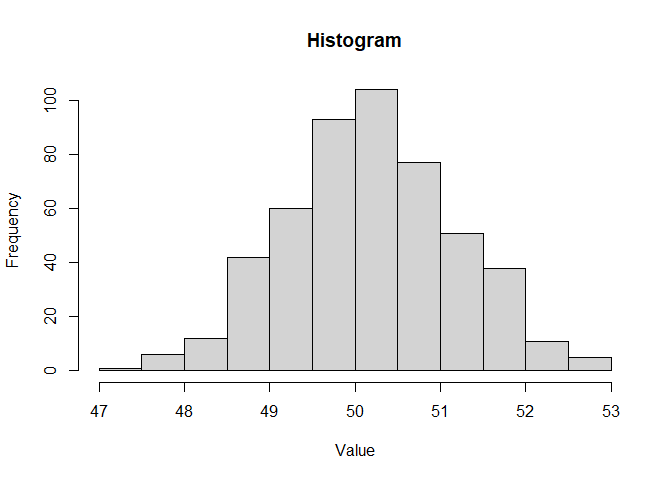
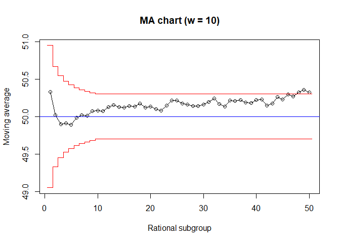
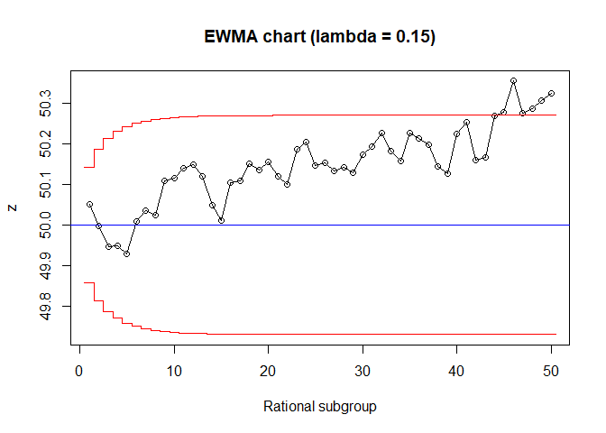

MA and EWMA charts for statistical process control
================
Raul Almuzara

 

### **Introduction**

We will work with a dataset which simulates the data that could have
been collected from one variable of an industrial process which, under
control, should follow a normal distribution $N(50,1)$. We suspect the
existence of a slow gradual malfunction. Data are collected in small
batches (rational subgroups). We will obtain Moving Average (MA) and
Exponentially Weighted Moving Average (EWMA) control charts using the
appropriate statistical techniques. Then, we will judge if the
industrial process is under control or if there could be a problem.

 

### **Analysis**

We will use the file *datacc4.txt*.

``` r
data4 <- read.delim('datacc4.txt', header = FALSE, sep = ' ', dec = '.')[,c(1,4)]
colnames(data4) <- c('Subgroup','Value')
data4
```

    ##     Subgroup    Value
    ## 1          1 48.58346
    ## 2          1 50.26995
    ## 3          1 50.18556
    ## 4          1 51.61356
    ## 5          1 51.57551
    ## 6          1 49.96707
    ## 7          1 49.94255
    ## 8          1 50.18942
    ## 9          1 51.01041
    ## 10         1 49.98910
    ## 11         2 48.99581
    ## 12         2 49.72474
    ## 13         2 49.51669
    ## 14         2 49.33543
    ## 15         2 50.46762
    ## 16         2 50.33177
    ## 17         2 51.37082
    ## 18         2 50.63146
    ## 19         2 48.81713
    ## 20         2 47.88933
    ## 21         3 49.62366
    ## 22         3 49.88836
    ## 23         3 51.65913
    ## 24         3 49.73489
    ## 25         3 50.08495
    ## 26         3 50.27725
    ## 27         3 49.19799
    ## 28         3 49.88418
    ## 29         3 48.06922
    ## 30         3 48.08034
    ## 31         4 49.91884
    ## 32         4 52.34423
    ## 33         4 50.40900
    ## 34         4 49.61964
    ## 35         4 48.55256
    ## 36         4 49.77457
    ## 37         4 49.49911
    ## 38         4 49.24103
    ## 39         4 49.92673
    ## 40         4 50.32399
    ## 41         5 49.94459
    ## 42         5 51.05919
    ## 43         5 49.95380
    ## 44         5 51.01568
    ## 45         5 49.46006
    ## 46         5 49.11521
    ## 47         5 49.98399
    ## 48         5 50.42909
    ## 49         5 49.45684
    ## 50         5 47.74194
    ## 51         6 50.09354
    ## 52         6 51.22869
    ## 53         6 52.52661
    ## 54         6 49.93597
    ## 55         6 49.67893
    ## 56         6 51.03418
    ## 57         6 49.52267
    ## 58         6 50.09081
    ## 59         6 50.15436
    ## 60         6 50.30846
    ## 61         7 49.57269
    ## 62         7 51.52703
    ## 63         7 48.96924
    ## 64         7 50.70517
    ## 65         7 49.38285
    ## 66         7 51.02268
    ## 67         7 49.72583
    ## 68         7 50.69093
    ## 69         7 50.34833
    ## 70         7 50.02069
    ## 71         8 50.09932
    ## 72         8 49.98206
    ## 73         8 49.00614
    ## 74         8 48.81274
    ## 75         8 50.00133
    ## 76         8 51.01835
    ## 77         8 48.93148
    ## 78         8 50.22859
    ## 79         8 50.54643
    ## 80         8 50.95866
    ## 81         9 51.14407
    ## 82         9 50.60662
    ## 83         9 49.98325
    ## 84         9 50.67135
    ## 85         9 50.01303
    ## 86         9 48.61185
    ## 87         9 51.64252
    ## 88         9 51.56153
    ## 89         9 51.11022
    ## 90         9 50.58352
    ## 91        10 51.86754
    ## 92        10 51.18066
    ## 93        10 48.73767
    ## 94        10 50.43851
    ## 95        10 50.31238
    ## 96        10 48.90393
    ## 97        10 50.34726
    ## 98        10 50.07788
    ## 99        10 49.77512
    ## 100       10 49.88439
    ## 101       11 50.59378
    ## 102       11 48.91718
    ## 103       11 49.53856
    ## 104       11 49.78798
    ## 105       11 50.44375
    ## 106       11 51.31216
    ## 107       11 50.22550
    ## 108       11 51.10643
    ## 109       11 50.58867
    ## 110       11 50.22060
    ## 111       12 49.25788
    ## 112       12 50.55598
    ## 113       12 51.36950
    ## 114       12 49.11417
    ## 115       12 49.14326
    ## 116       12 50.55969
    ## 117       12 49.78804
    ## 118       12 50.71689
    ## 119       12 51.54837
    ## 120       12 49.89117
    ## 121       13 51.02864
    ## 122       13 49.79002
    ## 123       13 49.46311
    ## 124       13 50.23586
    ## 125       13 50.11319
    ## 126       13 49.91840
    ## 127       13 50.85067
    ## 128       13 48.84098
    ## 129       13 49.61126
    ## 130       13 49.74509
    ## 131       14 50.00639
    ## 132       14 48.81601
    ## 133       14 50.32693
    ## 134       14 49.23330
    ## 135       14 48.06846
    ## 136       14 50.64691
    ## 137       14 50.69653
    ## 138       14 49.60862
    ## 139       14 49.68024
    ## 140       14 49.36074
    ## 141       15 49.60481
    ## 142       15 49.86533
    ## 143       15 48.78335
    ## 144       15 49.11767
    ## 145       15 49.66207
    ## 146       15 49.54213
    ## 147       15 51.66078
    ## 148       15 49.96980
    ## 149       15 51.42075
    ## 150       15 48.33126
    ## 151       16 50.22231
    ## 152       16 52.75650
    ## 153       16 49.51274
    ## 154       16 50.87519
    ## 155       16 48.64201
    ## 156       16 50.92718
    ## 157       16 49.50253
    ## 158       16 50.77762
    ## 159       16 51.73542
    ## 160       16 51.33121
    ## 161       17 49.20408
    ## 162       17 49.25863
    ## 163       17 51.74549
    ## 164       17 50.11022
    ## 165       17 50.45476
    ## 166       17 50.06687
    ## 167       17 49.17316
    ## 168       17 50.40535
    ## 169       17 50.07947
    ## 170       17 50.96412
    ## 171       18 50.61894
    ## 172       18 51.51009
    ## 173       18 48.93741
    ## 174       18 50.67769
    ## 175       18 49.39437
    ## 176       18 51.71761
    ## 177       18 49.80656
    ## 178       18 49.43549
    ## 179       18 51.03177
    ## 180       18 50.71962
    ## 181       19 51.05012
    ## 182       19 49.83528
    ## 183       19 50.91609
    ## 184       19 49.47956
    ## 185       19 49.69647
    ## 186       19 50.17710
    ## 187       19 50.01004
    ## 188       19 50.05305
    ## 189       19 49.64836
    ## 190       19 49.54209
    ## 191       20 49.34318
    ## 192       20 49.58155
    ## 193       20 51.62755
    ## 194       20 50.60162
    ## 195       20 50.26008
    ## 196       20 51.15615
    ## 197       20 50.66229
    ## 198       20 48.53930
    ## 199       20 50.28600
    ## 200       20 50.62624
    ## 201       21 48.80847
    ## 202       21 50.69315
    ## 203       21 51.74944
    ## 204       21 50.68320
    ## 205       21 48.87002
    ## 206       21 49.93823
    ## 207       21 49.39843
    ## 208       21 50.83096
    ## 209       21 49.11449
    ## 210       21 49.14049
    ## 211       22 49.28564
    ## 212       22 50.16538
    ## 213       22 48.42958
    ## 214       22 50.93474
    ## 215       22 48.69801
    ## 216       22 50.92412
    ## 217       22 50.36041
    ## 218       22 49.87853
    ## 219       22 50.39173
    ## 220       22 50.75429
    ## 221       23 51.44876
    ## 222       23 50.72957
    ## 223       23 51.28236
    ## 224       23 50.81685
    ## 225       23 49.89545
    ## 226       23 51.69904
    ## 227       23 49.37524
    ## 228       23 49.83112
    ## 229       23 51.68201
    ## 230       23 50.03557
    ## 231       24 49.78438
    ## 232       24 50.42710
    ## 233       24 50.00506
    ## 234       24 51.25293
    ## 235       24 50.50635
    ## 236       24 49.76103
    ## 237       24 49.23444
    ## 238       24 51.03174
    ## 239       24 50.37555
    ## 240       24 50.69241
    ## 241       25 50.78034
    ## 242       25 49.32580
    ## 243       25 51.55135
    ## 244       25 48.97595
    ## 245       25 50.65766
    ## 246       25 49.93502
    ## 247       25 49.28083
    ## 248       25 49.48844
    ## 249       25 50.15657
    ## 250       25 47.98451
    ## 251       26 48.50521
    ## 252       26 51.93295
    ## 253       26 50.43245
    ## 254       26 49.34525
    ## 255       26 51.56054
    ## 256       26 52.18748
    ## 257       26 49.57548
    ## 258       26 50.31187
    ## 259       26 49.85946
    ## 260       26 48.18554
    ## 261       27 51.17446
    ## 262       27 49.27714
    ## 263       27 48.51748
    ## 264       27 50.59042
    ## 265       27 51.78092
    ## 266       27 48.97371
    ## 267       27 49.13111
    ## 268       27 49.70084
    ## 269       27 50.89700
    ## 270       27 50.24734
    ## 271       28 48.49501
    ## 272       28 49.35711
    ## 273       28 51.06072
    ## 274       28 49.81609
    ## 275       28 49.38418
    ## 276       28 50.41668
    ## 277       28 52.57159
    ## 278       28 48.98849
    ## 279       28 51.54198
    ## 280       28 50.18809
    ## 281       29 51.65493
    ## 282       29 50.65556
    ## 283       29 48.98442
    ## 284       29 51.99971
    ## 285       29 50.03521
    ## 286       29 49.50023
    ## 287       29 48.72830
    ## 288       29 49.55503
    ## 289       29 49.97856
    ## 290       29 49.53553
    ## 291       30 49.14967
    ## 292       30 50.29816
    ## 293       30 50.33046
    ## 294       30 50.45961
    ## 295       30 51.68230
    ## 296       30 48.54700
    ## 297       30 50.69917
    ## 298       30 51.87524
    ## 299       30 51.61673
    ## 300       30 49.55365
    ## 301       31 48.98165
    ## 302       31 52.08600
    ## 303       31 51.31391
    ## 304       31 51.86510
    ## 305       31 50.11777
    ## 306       31 49.40910
    ## 307       31 48.85892
    ## 308       31 49.52449
    ## 309       31 50.02525
    ## 310       31 50.93851
    ## 311       32 52.35335
    ## 312       32 49.33657
    ## 313       32 50.94705
    ## 314       32 50.23429
    ## 315       32 51.37068
    ## 316       32 50.48610
    ## 317       32 51.43697
    ## 318       32 50.57827
    ## 319       32 47.72582
    ## 320       32 49.66272
    ## 321       33 49.41250
    ## 322       33 51.01280
    ## 323       33 49.58961
    ## 324       33 49.23207
    ## 325       33 51.27696
    ## 326       33 49.38390
    ## 327       33 50.18371
    ## 328       33 50.66325
    ## 329       33 49.55177
    ## 330       33 49.04219
    ## 331       34 50.63441
    ## 332       34 49.20867
    ## 333       34 51.98615
    ## 334       34 49.14487
    ## 335       34 50.54672
    ## 336       34 49.30412
    ## 337       34 48.73305
    ## 338       34 50.00385
    ## 339       34 50.42892
    ## 340       34 50.08337
    ## 341       35 51.10950
    ## 342       35 51.40758
    ## 343       35 52.34122
    ## 344       35 51.38548
    ## 345       35 48.71870
    ## 346       35 49.38823
    ## 347       35 50.73107
    ## 348       35 50.94181
    ## 349       35 49.26739
    ## 350       35 51.01029
    ## 351       36 50.31500
    ## 352       36 50.34922
    ## 353       36 47.44067
    ## 354       36 50.77656
    ## 355       36 49.89609
    ## 356       36 50.86309
    ## 357       36 50.64972
    ## 358       36 49.46549
    ## 359       36 51.34515
    ## 360       36 50.14188
    ## 361       37 50.19257
    ## 362       37 50.44093
    ## 363       37 49.95640
    ## 364       37 49.62176
    ## 365       37 49.30011
    ## 366       37 49.29749
    ## 367       37 50.71715
    ## 368       37 50.04734
    ## 369       37 51.40819
    ## 370       37 50.14678
    ## 371       38 50.54740
    ## 372       38 50.01733
    ## 373       38 50.05627
    ## 374       38 48.40042
    ## 375       38 50.16560
    ## 376       38 49.79274
    ## 377       38 52.44590
    ## 378       38 47.96502
    ## 379       38 48.00905
    ## 380       38 51.03700
    ## 381       39 49.40293
    ## 382       39 48.95898
    ## 383       39 50.11566
    ## 384       39 51.20491
    ## 385       39 50.99338
    ## 386       39 51.00761
    ## 387       39 50.31632
    ## 388       39 50.26484
    ## 389       39 48.01650
    ## 390       39 49.96660
    ## 391       40 50.29291
    ## 392       40 52.43695
    ## 393       40 50.14997
    ## 394       40 52.04107
    ## 395       40 50.72798
    ## 396       40 50.27612
    ## 397       40 48.37482
    ## 398       40 49.92735
    ## 399       40 52.27695
    ## 400       40 51.35616
    ## 401       41 49.21635
    ## 402       41 51.28778
    ## 403       41 50.77935
    ## 404       41 49.51803
    ## 405       41 50.79005
    ## 406       41 49.88209
    ## 407       41 50.05887
    ## 408       41 49.98371
    ## 409       41 50.75581
    ## 410       41 51.80772
    ## 411       42 51.50780
    ## 412       42 50.44807
    ## 413       42 50.19663
    ## 414       42 48.78288
    ## 415       42 48.55881
    ## 416       42 48.72613
    ## 417       42 49.13103
    ## 418       42 49.87201
    ## 419       42 49.57715
    ## 420       42 49.57645
    ## 421       43 50.16540
    ## 422       43 50.21909
    ## 423       43 49.60617
    ## 424       43 49.89675
    ## 425       43 52.64107
    ## 426       43 49.81821
    ## 427       43 49.37590
    ## 428       43 50.28076
    ## 429       43 49.66355
    ## 430       43 50.33063
    ## 431       44 50.90346
    ## 432       44 49.33390
    ## 433       44 50.19662
    ## 434       44 51.44223
    ## 435       44 51.85424
    ## 436       44 51.73861
    ## 437       44 51.04535
    ## 438       44 49.78539
    ## 439       44 51.59359
    ## 440       44 50.64651
    ## 441       45 51.23055
    ## 442       45 50.34923
    ## 443       45 49.57434
    ## 444       45 51.76958
    ## 445       45 50.60465
    ## 446       45 48.35633
    ## 447       45 50.27190
    ## 448       45 51.05178
    ## 449       45 50.69898
    ## 450       45 49.39130
    ## 451       46 50.60758
    ## 452       46 52.96697
    ## 453       46 50.43378
    ## 454       46 51.89275
    ## 455       46 49.95906
    ## 456       46 48.94518
    ## 457       46 51.16467
    ## 458       46 51.05127
    ## 459       46 50.57771
    ## 460       46 50.25544
    ## 461       47 49.51399
    ## 462       47 48.62147
    ## 463       47 49.30876
    ## 464       47 48.83478
    ## 465       47 51.24055
    ## 466       47 50.79361
    ## 467       47 52.28493
    ## 468       47 49.81112
    ## 469       47 49.22961
    ## 470       47 48.70969
    ## 471       48 50.84451
    ## 472       48 50.52839
    ## 473       48 50.83168
    ## 474       48 50.30289
    ## 475       48 48.80179
    ## 476       48 50.33409
    ## 477       48 51.40882
    ## 478       48 49.74452
    ## 479       48 49.83657
    ## 480       48 50.78213
    ## 481       49 51.12513
    ## 482       49 50.20660
    ## 483       49 51.52126
    ## 484       49 47.92633
    ## 485       49 49.92688
    ## 486       49 50.93414
    ## 487       49 51.71915
    ## 488       49 50.74230
    ## 489       49 50.08352
    ## 490       49 50.01495
    ## 491       50 50.15036
    ## 492       50 50.71684
    ## 493       50 50.94234
    ## 494       50 50.62074
    ## 495       50 48.51624
    ## 496       50 50.39785
    ## 497       50 49.95232
    ## 498       50 50.35320
    ## 499       50 52.34478
    ## 500       50 50.26144

Number of subgroups and samples in each one.

``` r
table(data4$Subgroup)
```

    ## 
    ##  1  2  3  4  5  6  7  8  9 10 11 12 13 14 15 16 17 18 19 20 21 22 23 24 25 26 
    ## 10 10 10 10 10 10 10 10 10 10 10 10 10 10 10 10 10 10 10 10 10 10 10 10 10 10 
    ## 27 28 29 30 31 32 33 34 35 36 37 38 39 40 41 42 43 44 45 46 47 48 49 50 
    ## 10 10 10 10 10 10 10 10 10 10 10 10 10 10 10 10 10 10 10 10 10 10 10 10

There are $k=50$ rational subgroups and $n=10$ samples in each subgroup.

``` r
k <- 50
n <- 10
```

Here is a histogram with all measurements.

``` r
hist(data4$Value, main = 'Histogram', xlab = 'Value', ylab = 'Frequency')
```

<!-- -->

The normality test tells us that we cannot reject the null hypothesis of
normal distribution.

``` r
shapiro.test(data4$Value)
```

    ## 
    ##  Shapiro-Wilk normality test
    ## 
    ## data:  data4$Value
    ## W = 0.99769, p-value = 0.7263

Assuming that the industrial process is well-known, if we suspect that
there is a gradual shift in the process mean, it is typical to build
charts using reference values rather than estimating parameters from
current data. When parameters are estimated from a process that might
already be off-target, the chart absorbs that bias, making it blind to
subtle shifts. With the help of reliable historical baseline values, we
will be able to flag gradual deviations from the ideal process target.

``` r
mu0 <- 50
sigma0 <- 1
```

We will also be using the mean of each rational subgroup.

``` r
means <- aggregate(data4$Value, list(data4$Subgroup), FUN=mean)[,2]
```

In order to analyze possible shifts that indicate a malfunction, we may
resort first to a standard Moving Average (MA) chart.

For a MA chart, we must compute the moving averages after having chosen
a window size $w$. In this case, we choose $w=10$.

``` r
w <- 10
```

For each step (subgroup), we calculate the mean of the current value and
up to the previous $w-1$ values, using an incomplete window when fewer
values are available.

``` r
moving_average <- function(values, window_size)
{
  values <- unlist(values, use.names = FALSE)
  result <- numeric(length(values))

  for (i in seq_along(values))
  {
    start <- max(1, i-window_size+1)
    result[i] <- mean(values[start:i])
  }

  result
}
```

We apply the previous function to the vector of means of subgroups to
obtain the moving averages with $w=10$.

``` r
mas <- moving_average(means, w)
```

The points that will appear in the MA control chart are those moving
averages:

``` r
names(mas) <- paste('Subgroup', 1:k)
print(mas)
```

    ##  Subgroup 1  Subgroup 2  Subgroup 3  Subgroup 4  Subgroup 5  Subgroup 6 
    ##    50.33266    50.02037    49.89691    49.91293    49.89355    49.98753 
    ##  Subgroup 7  Subgroup 8  Subgroup 9 Subgroup 10 Subgroup 11 Subgroup 12 
    ##    50.01739    50.01003    50.07478    50.08256    50.07664    50.12528 
    ## Subgroup 13 Subgroup 14 Subgroup 15 Subgroup 16 Subgroup 17 Subgroup 18 
    ##    50.15625    50.12459    50.12257    50.13965    50.13462    50.17727 
    ## Subgroup 19 Subgroup 20 Subgroup 21 Subgroup 22 Subgroup 23 Subgroup 24 
    ##    50.12207    50.13365    50.09858    50.07735    50.14934    50.21561 
    ## Subgroup 25 Subgroup 26 Subgroup 27 Subgroup 28 Subgroup 29 Subgroup 30 
    ##    50.21739    50.17353    50.16181    50.14151    50.14371    50.15899 
    ## Subgroup 31 Subgroup 32 Subgroup 33 Subgroup 34 Subgroup 35 Subgroup 36 
    ##    50.19793    50.24102    50.16655    50.13658    50.21823    50.21169 
    ## Subgroup 37 Subgroup 38 Subgroup 39 Subgroup 40 Subgroup 41 Subgroup 42 
    ##    50.22008    50.18624    50.18245    50.21893    50.22852    50.15097 
    ## Subgroup 43 Subgroup 44 Subgroup 45 Subgroup 46 Subgroup 47 Subgroup 48 
    ##    50.17746    50.26212    50.23209    50.29821    50.27040    50.32019 
    ## Subgroup 49 Subgroup 50 
    ##    50.35972    50.32367

Let $i=1,\ldots,k$ (where $k=50$ subgroups in this case). The relevant
lines of the MA chart are:

– The center line (blue). A flat line:

$$CL = \mu_0 \\\approx 50$$

– The lower control limit (red). Each point associated with each
subgroup $i$ will have a different value for the lower control line:

$$LCL(i) = \mu_0 - 3\frac{\sigma_0}{\sqrt{n\cdot\min(i,w)}} \\\approx 50-3\frac{1}{\sqrt{10\cdot\min(i,10)}}$$

– The upper control limit (red). Each point associated with each
subgroup $i$ will have a different value for the upper control line:

$$UCL(i) = \mu_0 + 3\frac{\sigma_0}{\sqrt{n\cdot\min(i,w)}} \\\approx 50+3\frac{1}{\sqrt{10\cdot\min(i,10)}}$$

The lower control limits of the MA chart for each rational subgroup are
the following:

``` r
i <- 1:k
lcl_ma <- mu0 - 3 * sigma0 / sqrt(n*pmin(i, w))
names(lcl_ma) <- paste('Subgroup', 1:k)
print(lcl_ma)
```

    ##  Subgroup 1  Subgroup 2  Subgroup 3  Subgroup 4  Subgroup 5  Subgroup 6 
    ##    49.05132    49.32918    49.45228    49.52566    49.57574    49.61270 
    ##  Subgroup 7  Subgroup 8  Subgroup 9 Subgroup 10 Subgroup 11 Subgroup 12 
    ##    49.64143    49.66459    49.68377    49.70000    49.70000    49.70000 
    ## Subgroup 13 Subgroup 14 Subgroup 15 Subgroup 16 Subgroup 17 Subgroup 18 
    ##    49.70000    49.70000    49.70000    49.70000    49.70000    49.70000 
    ## Subgroup 19 Subgroup 20 Subgroup 21 Subgroup 22 Subgroup 23 Subgroup 24 
    ##    49.70000    49.70000    49.70000    49.70000    49.70000    49.70000 
    ## Subgroup 25 Subgroup 26 Subgroup 27 Subgroup 28 Subgroup 29 Subgroup 30 
    ##    49.70000    49.70000    49.70000    49.70000    49.70000    49.70000 
    ## Subgroup 31 Subgroup 32 Subgroup 33 Subgroup 34 Subgroup 35 Subgroup 36 
    ##    49.70000    49.70000    49.70000    49.70000    49.70000    49.70000 
    ## Subgroup 37 Subgroup 38 Subgroup 39 Subgroup 40 Subgroup 41 Subgroup 42 
    ##    49.70000    49.70000    49.70000    49.70000    49.70000    49.70000 
    ## Subgroup 43 Subgroup 44 Subgroup 45 Subgroup 46 Subgroup 47 Subgroup 48 
    ##    49.70000    49.70000    49.70000    49.70000    49.70000    49.70000 
    ## Subgroup 49 Subgroup 50 
    ##    49.70000    49.70000

The upper control limits of the MA chart for each rational subgroup are
the following:

``` r
i <- 1:k
ucl_ma <- mu0 + 3 * sigma0 / sqrt(n*pmin(i, w))
names(ucl_ma) <- paste('Subgroup', 1:k)
print(ucl_ma)
```

    ##  Subgroup 1  Subgroup 2  Subgroup 3  Subgroup 4  Subgroup 5  Subgroup 6 
    ##    50.94868    50.67082    50.54772    50.47434    50.42426    50.38730 
    ##  Subgroup 7  Subgroup 8  Subgroup 9 Subgroup 10 Subgroup 11 Subgroup 12 
    ##    50.35857    50.33541    50.31623    50.30000    50.30000    50.30000 
    ## Subgroup 13 Subgroup 14 Subgroup 15 Subgroup 16 Subgroup 17 Subgroup 18 
    ##    50.30000    50.30000    50.30000    50.30000    50.30000    50.30000 
    ## Subgroup 19 Subgroup 20 Subgroup 21 Subgroup 22 Subgroup 23 Subgroup 24 
    ##    50.30000    50.30000    50.30000    50.30000    50.30000    50.30000 
    ## Subgroup 25 Subgroup 26 Subgroup 27 Subgroup 28 Subgroup 29 Subgroup 30 
    ##    50.30000    50.30000    50.30000    50.30000    50.30000    50.30000 
    ## Subgroup 31 Subgroup 32 Subgroup 33 Subgroup 34 Subgroup 35 Subgroup 36 
    ##    50.30000    50.30000    50.30000    50.30000    50.30000    50.30000 
    ## Subgroup 37 Subgroup 38 Subgroup 39 Subgroup 40 Subgroup 41 Subgroup 42 
    ##    50.30000    50.30000    50.30000    50.30000    50.30000    50.30000 
    ## Subgroup 43 Subgroup 44 Subgroup 45 Subgroup 46 Subgroup 47 Subgroup 48 
    ##    50.30000    50.30000    50.30000    50.30000    50.30000    50.30000 
    ## Subgroup 49 Subgroup 50 
    ##    50.30000    50.30000

With all the information above, we plot the MA chart.

``` r
plot(i, mas, type='o', main=paste0('MA chart (w = ', w, ')'), xlab='Rational subgroup', ylab='Moving average', ylim=range(c(mas, lcl_ma, ucl_ma)))
abline(h=mu0, col='blue')
segments(x0=i-0.5, y0=lcl_ma, x1=i+0.5, y1=lcl_ma, col='red')
segments(x0=i[-k]+0.5, y0=lcl_ma[-k], x1=i[-k]+0.5, y1=lcl_ma[-1], col='red')
segments(x0=i-0.5, y0=ucl_ma, x1=i+0.5, y1=ucl_ma, col='red')
segments(x0=i[-k]+0.5, y0=ucl_ma[-k], x1=i[-k]+0.5, y1=ucl_ma[-1], col='red')
```

<!-- -->

 

Another popular type of chart that is useful for analyzing gradual
shifts is the Exponentially Weighted Moving Average (EWMA) chart.

For the EWMA chart, we must specify a smoothing parameter (or weighting
factor) $\lambda$. In this case, we will choose $\lambda=0.15$, which is
relatively small and will work well for detecting small gradual changes.

``` r
lambda <- 0.15
```

We obtain the points of the EWMA chart with the following recursion:

$$z_i = \lambda\overline{x}_i + (1-\lambda)z_{i-1},\quad z_0=\mu_0,\quad i=1,\ldots, k$$

``` r
z <- numeric(k)

z[1] <- lambda*means[1] + (1-lambda)*mu0

for (i in 2:k)
{
  z[i] <- lambda*means[i] + (1-lambda)*z[i-1]
}
```

The points that will appear in the EWMA control chart are the following:

``` r
names(z) <- paste('Subgroup', 1:k)
print(z)
```

    ##  Subgroup 1  Subgroup 2  Subgroup 3  Subgroup 4  Subgroup 5  Subgroup 6 
    ##    50.04990    49.99863    49.94633    49.94853    49.92865    50.00797 
    ##  Subgroup 7  Subgroup 8  Subgroup 9 Subgroup 10 Subgroup 11 Subgroup 12 
    ##    50.03626    50.02459    50.10982    50.11623    50.13982    50.14802 
    ## Subgroup 13 Subgroup 14 Subgroup 15 Subgroup 16 Subgroup 17 Subgroup 18 
    ##    50.11977    50.04847    50.01057    50.10322    50.10967    50.15096 
    ## Subgroup 19 Subgroup 20 Subgroup 21 Subgroup 22 Subgroup 23 Subgroup 24 
    ##    50.13444    50.15454    50.11976    50.09913    50.18620    50.20434 
    ## Subgroup 25 Subgroup 26 Subgroup 27 Subgroup 28 Subgroup 29 Subgroup 30 
    ##    50.14573    50.15232    50.13382    50.14105    50.12930    50.17309 
    ## Subgroup 31 Subgroup 32 Subgroup 33 Subgroup 34 Subgroup 35 Subgroup 36 
    ##    50.19394    50.22682    50.18303    50.15669    50.22770    50.21219 
    ## Subgroup 37 Subgroup 38 Subgroup 39 Subgroup 40 Subgroup 41 Subgroup 42 
    ##    50.19729    50.14425    50.12633    50.22528    50.25269    50.16044 
    ## Subgroup 43 Subgroup 44 Subgroup 45 Subgroup 46 Subgroup 47 Subgroup 48 
    ##    50.16634    50.26948    50.27854    50.35458    50.27662    50.28636 
    ## Subgroup 49 Subgroup 50 
    ##    50.30641    50.32429

Let $i=1,\ldots,k$ (where $k=50$ subgroups in this case). The relevant
lines of the EWMA chart are:

– The center line (blue). A flat line:

$$CL = \mu_0 \\\approx 50$$

– The lower control limit (red). Each point associated with each
subgroup $i$ will have a different value for the lower control line:

$$LCL(i) = \mu_0 - 3\frac{\sigma_0}{\sqrt{n}}\sqrt{\frac{\lambda}{2-\lambda}\left[1-(1-\lambda)^{2i}\right]} \\\approx 50 - 3 \frac{1}{\sqrt{10}}\sqrt{\frac{0.15}{2-0.15}\left[1-(1-0.15)^{2i}\right]}$$

– The upper control limit (red). Each point associated with each
subgroup $i$ will have a different value for the upper control line:

$$UCL(i) = \mu_0 + 3\frac{\sigma_0}{\sqrt{n}}\sqrt{\frac{\lambda}{2-\lambda}\left[1-(1-\lambda)^{2i}\right]} \\\approx 50 + 3 \frac{1}{\sqrt{10}}\sqrt{\frac{0.15}{2-0.15}\left[1-(1-0.15)^{2i}\right]}$$

The lower control limits of the EWMA chart for each rational subgroup
are the following:

``` r
i <- 1:k
lcl_ewma <- mu0 - 3 * (sigma0/sqrt(n)) * sqrt((lambda/(2-lambda))*(1-(1-lambda)^(2*i)))
names(lcl_ewma) <- paste('Subgroup', 1:k)
print(lcl_ewma)
```

    ##  Subgroup 1  Subgroup 2  Subgroup 3  Subgroup 4  Subgroup 5  Subgroup 6 
    ##    49.85770    49.81324    49.78681    49.76959    49.75791    49.74981 
    ##  Subgroup 7  Subgroup 8  Subgroup 9 Subgroup 10 Subgroup 11 Subgroup 12 
    ##    49.74412    49.74009    49.73721    49.73515    49.73367    49.73261 
    ## Subgroup 13 Subgroup 14 Subgroup 15 Subgroup 16 Subgroup 17 Subgroup 18 
    ##    49.73185    49.73130    49.73090    49.73061    49.73040    49.73025 
    ## Subgroup 19 Subgroup 20 Subgroup 21 Subgroup 22 Subgroup 23 Subgroup 24 
    ##    49.73015    49.73007    49.73001    49.72997    49.72994    49.72992 
    ## Subgroup 25 Subgroup 26 Subgroup 27 Subgroup 28 Subgroup 29 Subgroup 30 
    ##    49.72990    49.72989    49.72989    49.72988    49.72988    49.72987 
    ## Subgroup 31 Subgroup 32 Subgroup 33 Subgroup 34 Subgroup 35 Subgroup 36 
    ##    49.72987    49.72987    49.72987    49.72987    49.72987    49.72987 
    ## Subgroup 37 Subgroup 38 Subgroup 39 Subgroup 40 Subgroup 41 Subgroup 42 
    ##    49.72987    49.72987    49.72987    49.72987    49.72987    49.72987 
    ## Subgroup 43 Subgroup 44 Subgroup 45 Subgroup 46 Subgroup 47 Subgroup 48 
    ##    49.72987    49.72986    49.72986    49.72986    49.72986    49.72986 
    ## Subgroup 49 Subgroup 50 
    ##    49.72986    49.72986

The upper control limits of the EWMA chart for each rational subgroup
are the following:

``` r
i <- 1:k
ucl_ewma <- mu0 + 3 * (sigma0/sqrt(n)) * sqrt((lambda/(2-lambda))*(1-(1-lambda)^(2*i)))
names(ucl_ewma) <- paste('Subgroup', 1:k)
print(ucl_ewma)
```

    ##  Subgroup 1  Subgroup 2  Subgroup 3  Subgroup 4  Subgroup 5  Subgroup 6 
    ##    50.14230    50.18676    50.21319    50.23041    50.24209    50.25019 
    ##  Subgroup 7  Subgroup 8  Subgroup 9 Subgroup 10 Subgroup 11 Subgroup 12 
    ##    50.25588    50.25991    50.26279    50.26485    50.26633    50.26739 
    ## Subgroup 13 Subgroup 14 Subgroup 15 Subgroup 16 Subgroup 17 Subgroup 18 
    ##    50.26815    50.26870    50.26910    50.26939    50.26960    50.26975 
    ## Subgroup 19 Subgroup 20 Subgroup 21 Subgroup 22 Subgroup 23 Subgroup 24 
    ##    50.26985    50.26993    50.26999    50.27003    50.27006    50.27008 
    ## Subgroup 25 Subgroup 26 Subgroup 27 Subgroup 28 Subgroup 29 Subgroup 30 
    ##    50.27010    50.27011    50.27011    50.27012    50.27012    50.27013 
    ## Subgroup 31 Subgroup 32 Subgroup 33 Subgroup 34 Subgroup 35 Subgroup 36 
    ##    50.27013    50.27013    50.27013    50.27013    50.27013    50.27013 
    ## Subgroup 37 Subgroup 38 Subgroup 39 Subgroup 40 Subgroup 41 Subgroup 42 
    ##    50.27013    50.27013    50.27013    50.27013    50.27013    50.27013 
    ## Subgroup 43 Subgroup 44 Subgroup 45 Subgroup 46 Subgroup 47 Subgroup 48 
    ##    50.27013    50.27014    50.27014    50.27014    50.27014    50.27014 
    ## Subgroup 49 Subgroup 50 
    ##    50.27014    50.27014

With all the information above, we plot the EWMA chart.

``` r
plot(i, z, type='o', main=paste0('EWMA chart (lambda = ', lambda, ')'), xlab='Rational subgroup', ylab='z', ylim=range(c(z, lcl_ewma, ucl_ewma)))
abline(h=mu0, col='blue')
segments(x0=i-0.5, y0=lcl_ewma, x1=i+0.5, y1=lcl_ewma, col='red')
segments(x0=i[-k]+0.5, y0=lcl_ewma[-k], x1=i[-k]+0.5, y1=lcl_ewma[-1], col='red')
segments(x0=i-0.5, y0=ucl_ewma, x1=i+0.5, y1=ucl_ewma, col='red')
segments(x0=i[-k]+0.5, y0=ucl_ewma[-k], x1=i[-k]+0.5, y1=ucl_ewma[-1], col='red')
```

<!-- -->

 

### **Conclusion**

In both the MA and the EWMA charts, the trend of the plotted points is
increasing throughout the subgroups, which suggests that the conditions
of the process may be changing over time. For the first subgroups, there
is no problem and we could say that the process is under control.
However, there comes a time when the points escape the control zone and
stay out for the following data. This means that the process gets out of
control. In the case of the MA chart, the first subgroup out of the
control zone is number 48, whereas in the case of the EWMA chart, the
first subgroup out of the control zone is number 45. The specific time
at which a process goes out of control depends on the choice of $w$ in
the MA chart and the choice of $\lambda$ in the EWMA chart. Here, we
have used $w=10$ and $\lambda=0.15$, but other values could be used
depending on business needs. In any case, both methods have worked well
to systematically detect a problem that becomes significant in the last
few measurements.
