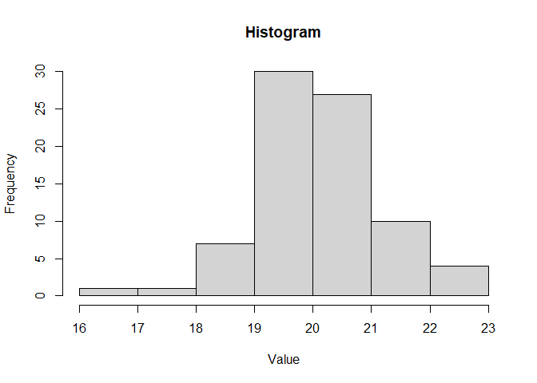
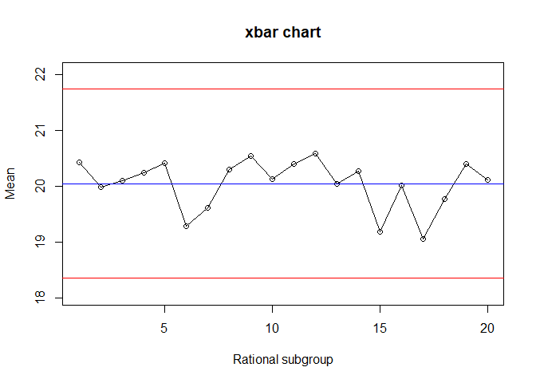
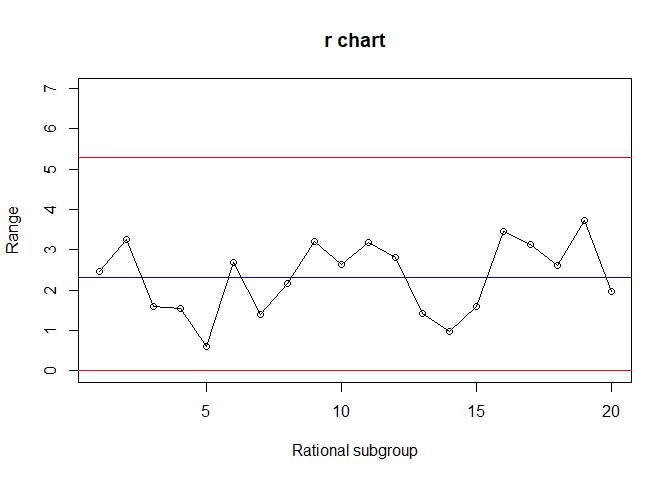

$\overline{x}$ and $r$ chart for statistical process control
================
Raul Almuzara

 

### **Introduction**

We will work with a dataset which simulates the data that could have
been collected from one variable of an industrial process with an
unknown reference mean and deviation. Data are collected in small
batches (rational subgroups). We will obtain an $\overline{x}$ and $r$
control chart using the appropriate statistical techniques. Then, we
will judge if the industrial process is under control or if there could
be a problem.

 

Tables of constants for control charts for each subgroup size can be
found at:

<https://web.mit.edu/2.810/www/files/readings/ControlChartConstantsAndFormulae.pdf>

<https://r-bar.net/control-chart-constants-tables-explanations/>

For the particular chart that we will obtain here, the fundamental
constants are $d_2(n)$ and $d_3(n)$, where $n$ is the number of values
in a rational subgroup. However, we will actually only need the
correction constants $A_2(n)$, $D_3(n)$ and $D_4(n)$ that can be
obtained from them. These values are typically tabulated.

``` r
A2 <- function(n)
{
  # constants A2 for subgroup sizes up to n=30
  
  if(n%%1==0 && n>=1 && n<=30)
  {
    vector_A2 <- c(NA, 1.8800, 1.0233, 0.7286, 0.5768, 0.4832, 0.4193, 0.3725, 0.3367, 0.3083, 0.2851, 0.2658, 0.2494, 0.2354, 0.2231, 0.2123, 0.2028, 0.1943, 0.1866, 0.1796, 0.1733, 0.1675, 0.1621, 0.1572, 0.1526, 0.1484, 0.1445, 0.1408, 0.1373, 0.1341)
    
    return(vector_A2[n])
  }
  
  else
  {
    return(NA)
  }
}
```

``` r
D3 <- function(n)
{
  # constants D3 for subgroup sizes up to n=30
  
  if(n%%1==0 && n>=1 && n<=30)
  {
    vector_D3 <- c(NA, 0.0000, 0.0000, 0.0000, 0.0000, 0.0000, 0.0757, 0.1362, 0.1840, 0.2230, 0.2556, 0.2833, 0.3072, 0.3281, 0.3466, 0.3630, 0.3779, 0.3913, 0.4035, 0.4147, 0.4250, 0.4345, 0.4434, 0.4516, 0.4593, 0.4665, 0.4733, 0.4797, 0.4857, 0.4914)
    
    return(vector_D3[n])
  }
  
  else
  {
    return(NA)
  }
}
```

``` r
D4 <- function(n)
{
  # constants D4 for subgroup sizes up to n=30
  
  if(n%%1==0 && n>=1 && n<=30)
  {
    vector_D4 <- c(NA, 3.2665, 2.5746, 2.2821, 2.1145, 2.0038, 1.9243, 1.8638, 1.8160, 1.7770, 1.7444, 1.7167, 1.6928, 1.6719, 1.6534, 1.6370, 1.6221, 1.6087, 1.5965, 1.5853, 1.5750, 1.5655, 1.5566, 1.5484, 1.5407, 1.5335, 1.5267, 1.5203, 1.5143, 1.5086)
    
    return(vector_D4[n])
  }
  
  else
  {
    return(NA)
  }
}
```

 

### **Analysis**

We will use the file *datacc2.txt*.

``` r
data2 <- read.delim('datacc2.txt', header = FALSE, sep = ' ', dec = '.')[,c(1,4)]
colnames(data2) <- c('Subgroup','Value')
data2
```

    ##    Subgroup    Value
    ## 1         1 20.65588
    ## 2         1 19.07727
    ## 3         1 20.43370
    ## 4         1 21.53279
    ## 5         2 20.53153
    ## 6         2 18.22762
    ## 7         2 19.71991
    ## 8         2 21.47111
    ## 9         3 19.15015
    ## 10        3 20.75440
    ## 11        3 20.31163
    ## 12        3 20.20571
    ## 13        4 20.09953
    ## 14        4 20.12405
    ## 15        4 21.14114
    ## 16        4 19.59291
    ## 17        5 20.45209
    ## 18        5 20.18110
    ## 19        5 20.24318
    ## 20        5 20.78610
    ## 21        6 20.30404
    ## 22        6 17.61746
    ## 23        6 18.96099
    ## 24        6 20.25825
    ## 25        7 19.07539
    ## 26        7 19.49030
    ## 27        7 20.46614
    ## 28        7 19.45622
    ## 29        8 21.35408
    ## 30        8 19.77894
    ## 31        8 20.89769
    ## 32        8 19.18587
    ## 33        9 19.48110
    ## 34        9 21.28400
    ## 35        9 19.08705
    ## 36        9 22.29956
    ## 37       10 21.71760
    ## 38       10 20.28273
    ## 39       10 19.46918
    ## 40       10 19.07520
    ## 41       11 22.11304
    ## 42       11 19.48474
    ## 43       11 21.08217
    ## 44       11 18.93285
    ## 45       12 20.40199
    ## 46       12 19.52532
    ## 47       12 20.08960
    ## 48       12 22.32202
    ## 49       13 19.31224
    ## 50       13 19.55615
    ## 51       13 20.56095
    ## 52       13 20.73318
    ## 53       14 19.86146
    ## 54       14 20.83788
    ## 55       14 20.03213
    ## 56       14 20.33380
    ## 57       15 19.89699
    ## 58       15 18.29863
    ## 59       15 19.09187
    ## 60       15 19.46327
    ## 61       16 20.17817
    ## 62       16 19.93357
    ## 63       16 21.70008
    ## 64       16 18.25823
    ## 65       17 16.78118
    ## 66       17 19.87912
    ## 67       17 19.65771
    ## 68       17 19.90568
    ## 69       18 21.44009
    ## 70       18 18.83385
    ## 71       18 19.12652
    ## 72       18 19.69605
    ## 73       19 22.38378
    ## 74       19 18.65830
    ## 75       19 20.70879
    ## 76       19 19.82647
    ## 77       20 19.30116
    ## 78       20 20.72420
    ## 79       20 19.23972
    ## 80       20 21.19934

Here is a histogram with all measurements.

``` r
hist(data2$Value, main = 'Histogram', xlab = 'Value', ylab = 'Frequency')
```

<!-- -->

We test for normality and we find that the null hypothesis of normal
data cannot be rejected.

``` r
shapiro.test(data2$Value)
```

    ## 
    ##  Shapiro-Wilk normality test
    ## 
    ## data:  data2$Value
    ## W = 0.98568, p-value = 0.5149

Number of samples in each rational subgroup.

``` r
table(data2$Subgroup)
```

    ## 
    ##  1  2  3  4  5  6  7  8  9 10 11 12 13 14 15 16 17 18 19 20 
    ##  4  4  4  4  4  4  4  4  4  4  4  4  4  4  4  4  4  4  4  4

That is $k=20$ rational subgroups with $n=4$ samples each.

``` r
k <- 20
n <- 4
```

Let’s compute the mean of each rational subgroup.

``` r
means <- aggregate(data2$Value, list(data2$Subgroup), FUN=mean)[,2]
```

Let’s compute the range of each rational subgroup.

``` r
ranges <- aggregate(data2$Value, list(data2$Subgroup), FUN=max)[,2] - aggregate(data2$Value, list(data2$Subgroup), FUN=min)[,2]
```

We need to compute $\overline{\overline{x}}$, which is the mean of all
the means computed inside every rational subgroup.

``` r
xbarbar <- mean(means)
xbarbar
```

    ## [1] 20.04495

Now, we compute $\overline{r}$, which is the mean of all the ranges
computed inside every rational subgroup.

``` r
rbar <- mean(ranges)
rbar
```

    ## [1] 2.319362

The points that will be plotted on the $\overline{x}$ chart are the
means of all rational subgroups.

``` r
names(means) <- paste('Subgroup', 1:k)
print(means)
```

    ##  Subgroup 1  Subgroup 2  Subgroup 3  Subgroup 4  Subgroup 5  Subgroup 6 
    ##    20.42491    19.98754    20.10547    20.23941    20.41562    19.28519 
    ##  Subgroup 7  Subgroup 8  Subgroup 9 Subgroup 10 Subgroup 11 Subgroup 12 
    ##    19.62201    20.30414    20.53793    20.13618    20.40320    20.58473 
    ## Subgroup 13 Subgroup 14 Subgroup 15 Subgroup 16 Subgroup 17 Subgroup 18 
    ##    20.04063    20.26632    19.18769    20.01751    19.05592    19.77413 
    ## Subgroup 19 Subgroup 20 
    ##    20.39434    20.11610

The relevant lines of the $\overline{x}$ chart are:

– The center line (blue):

$$CL = \overline{\overline{x}} \\\approx 20.0450$$

– The lower control limit (red):

$$LCL = \overline{\overline{x}} - A_2(n)\cdot\overline{r} \\\approx 20.0450 - 0.7286\cdot 2.3194 \\\approx 18.3551$$

– The upper control limit (red):

$$UCL = \overline{\overline{x}} + A_2(n)\cdot\overline{r} \\\approx 20.0450 + 0.7286\cdot 2.3194 \\\approx 21.7349$$

With all the information above, we plot the $\overline{x}$ chart.

``` r
plot(1:k, means, type='o', main = 'xbar chart', xlab = 'Rational subgroup', ylab = 'Mean', ylim = c(0.9*xbarbar, 1.1*xbarbar))
abline(h=xbarbar, col='blue')
abline(h=xbarbar-A2(n)*rbar, col='red')
abline(h=xbarbar+A2(n)*rbar, col='red')
```

<!-- -->

 

The points that will be plotted on the $r$ chart are the ranges of all
rational subgroups.

``` r
names(ranges) <- paste('Subgroup', 1:k)
print(ranges)
```

    ##  Subgroup 1  Subgroup 2  Subgroup 3  Subgroup 4  Subgroup 5  Subgroup 6 
    ##   2.4555209   3.2434966   1.6042479   1.5482291   0.6049996   2.6865764 
    ##  Subgroup 7  Subgroup 8  Subgroup 9 Subgroup 10 Subgroup 11 Subgroup 12 
    ##   1.3907506   2.1682112   3.2125068   2.6424019   3.1801894   2.7966988 
    ## Subgroup 13 Subgroup 14 Subgroup 15 Subgroup 16 Subgroup 17 Subgroup 18 
    ##   1.4209379   0.9764179   1.5983620   3.4418510   3.1244948   2.6062437 
    ## Subgroup 19 Subgroup 20 
    ##   3.7254777   1.9596253

The relevant lines of the $r$ chart are:

– The center line (blue):

$$CL = \overline{r} \\\approx 2.3194$$

– The lower control limit (red):

$$LCL = D_3(n)\cdot\overline{r} \\\approx 0.0000\cdot 2.3194 \\\approx 0.0000$$

– The upper control limit (red):

$$UCL = D_4(n)\cdot\overline{r} \\\approx 2.2821\cdot 2.3194 \\\approx 5.2931$$

With all the information above, we plot the $r$ chart.

``` r
plot(1:k, ranges, type='o', main = 'r chart', xlab = 'Rational subgroup', ylab = 'Range', ylim=c(0, 3*rbar))
abline(h=rbar, col='blue')
abline(h=D3(n)*rbar, col='red')
abline(h=D4(n)*rbar, col='red')
```

<!-- -->

 

### **Conclusion**

For both parts of the $\overline{x}$ and $r$ chart, all the points are
below the upper control limit and above the lower control limit, so the
process seems to be under control.
