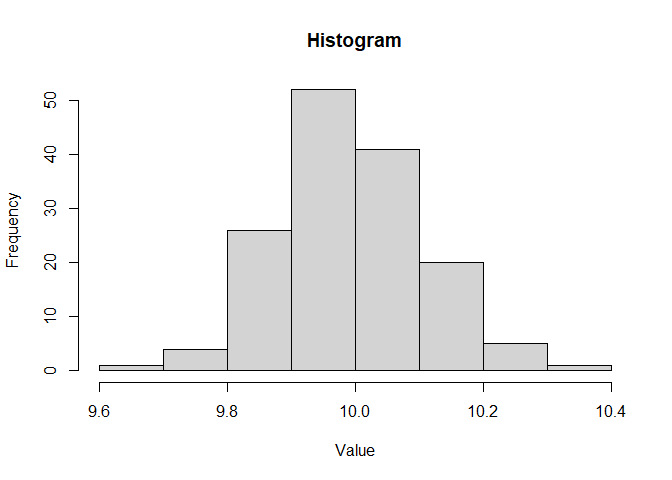
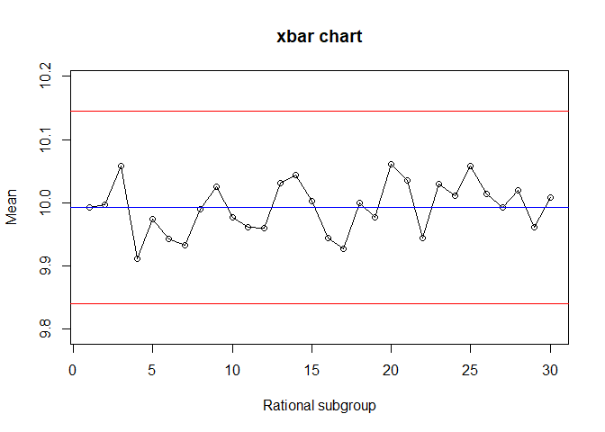
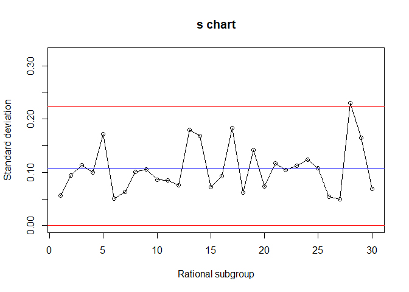

$\overline{x}$ and $s$ chart for statistical process control
================
Raul Almuzara

 

### **Introduction**

We will work with a dataset which simulates the data that could have
been collected from one variable of an industrial process with an
unknown reference mean and deviation. Data are collected in small
batches (rational subgroups). We will obtain an $\overline{x}$ and $s$
control chart using the appropriate statistical techniques. Then, we
will judge if the industrial process is under control or if there could
be a problem.

 

Tables of constants for control charts for each subgroup size can be
found at:

<https://web.mit.edu/2.810/www/files/readings/ControlChartConstantsAndFormulae.pdf>

<https://r-bar.net/control-chart-constants-tables-explanations/>

For the particular chart that we will obtain here, the fundamental
constant is $c_4(n)$, where $n$ is the number of values in a rational
subgroup. However, we will actually only need the correction constants
$A_3(n)$, $B_3(n)$ and $B_4(n)$ that can be obtained from it. These
values are typically tabulated.

``` r
A3 <- function(n)
{
  # constants A3 for subgroup sizes up to n=30
  
  if(n%%1==0 && n>=1 && n<=30)
  {
    vector_A3 <- c(NA, 2.6587, 1.9544, 1.6281, 1.4273, 1.2871, 1.1819, 1.0991, 1.0317, 0.9754, 0.9274, 0.8859, 0.8495, 0.8173, 0.7885, 0.7626, 0.7391, 0.7176, 0.6979, 0.6797, 0.6629, 0.6473, 0.6327, 0.6191, 0.6063, 0.5943, 0.5829, 0.5722, 0.5621, 0.5525)
    
    return(vector_A3[n])
  }
  
  else
  {
    return(NA)
  }
}
```

``` r
B3 <- function(n)
{
  # constants B3 for subgroup sizes up to n=30
  
  if(n%%1==0 && n>=1 && n<=30)
  {
    vector_B3 <- c(NA, 0.0000, 0.0000, 0.0000, 0.0000, 0.0304, 0.1177, 0.1851, 0.2391, 0.2837, 0.3213, 0.3535, 0.3816, 0.4062, 0.4282, 0.4479, 0.4657, 0.4818, 0.4966, 0.5102, 0.5228, 0.5344, 0.5452, 0.5553, 0.5648, 0.5737, 0.5820, 0.5899, 0.5974, 0.6044)
    
    return(vector_B3[n])
  }
  
  else
  {
    return(NA)
  }
}
```

``` r
B4 <- function(n)
{
  # constants B4 for subgroup sizes up to n=30
  
  if(n%%1==0 && n>=1 && n<=30)
  {
    vector_B4 <- c(NA, 3.2665, 2.5682, 2.2660, 2.0890, 1.9696, 1.8823, 1.8149, 1.7609, 1.7163, 1.6787, 1.6465, 1.6184, 1.5938, 1.5718, 1.5521, 1.5343, 1.5182, 1.5034, 1.4898, 1.4772, 1.4656, 1.4548, 1.4447, 1.4352, 1.4263, 1.4180, 1.4101, 1.4026, 1.3956)
    
    return(vector_B4[n])
  }
  
  else
  {
    return(NA)
  }
}
```

 

### **Analysis**

We will use the file *datacc1.txt*.

``` r
data1 <- read.delim('datacc1.txt', header = FALSE, sep = ' ', dec = '.')[,c(1,4)]
colnames(data1) <- c('Subgroup','Value')
data1
```

    ##     Subgroup     Value
    ## 1          1  9.937568
    ## 2          1  9.953563
    ## 3          1 10.015903
    ## 4          1 10.077521
    ## 5          1  9.975793
    ## 6          2 10.092923
    ## 7          2  9.899032
    ## 8          2 10.023442
    ## 9          2  9.898352
    ## 10         2 10.073718
    ## 11         3  9.869472
    ## 12         3 10.074305
    ## 13         3 10.171462
    ## 14         3 10.105308
    ## 15         3 10.073067
    ## 16         4  9.818599
    ## 17         4  9.792464
    ## 18         4 10.005959
    ## 19         4  9.996823
    ## 20         4  9.941248
    ## 21         5  9.809698
    ## 22         5  9.884091
    ## 23         5 10.138093
    ## 24         5 10.180280
    ## 25         5  9.860345
    ## 26         6  9.910058
    ## 27         6  9.902700
    ## 28         6  9.918866
    ## 29         6  9.960437
    ## 30         6 10.025304
    ## 31         7  9.920014
    ## 32         7  9.925733
    ## 33         7  9.855754
    ## 34         7 10.032077
    ## 35         7  9.928165
    ## 36         8 10.090957
    ## 37         8 10.093188
    ## 38         8  9.894058
    ## 39         8  9.885602
    ## 40         8  9.987288
    ## 41         9 10.060197
    ## 42         9 10.147332
    ## 43         9  9.948753
    ## 44         9  9.886015
    ## 45         9 10.083279
    ## 46        10  9.943127
    ## 47        10  9.943013
    ## 48        10 10.129484
    ## 49        10  9.920764
    ## 50        10  9.946789
    ## 51        11  9.904652
    ## 52        11  9.980169
    ## 53        11 10.084996
    ## 54        11  9.979065
    ## 55        11  9.861759
    ## 56        12  9.964640
    ## 57        12  9.989534
    ## 58        12  9.835774
    ## 59        12  9.967884
    ## 60        12 10.042230
    ## 61        13  9.869529
    ## 62        13 10.038470
    ## 63        13  9.834621
    ## 64        13 10.249226
    ## 65        13 10.161533
    ## 66        14 10.212426
    ## 67        14 10.002932
    ## 68        14 10.112909
    ## 69        14 10.118015
    ## 70        14  9.773282
    ## 71        15 10.085227
    ## 72        15  9.981502
    ## 73        15 10.002723
    ## 74        15  9.895199
    ## 75        15 10.045603
    ## 76        16  9.827963
    ## 77        16 10.056507
    ## 78        16 10.018930
    ## 79        16  9.921954
    ## 80        16  9.898946
    ## 81        17  9.646724
    ## 82        17 10.101523
    ## 83        17 10.079348
    ## 84        17  9.932520
    ## 85        17  9.877975
    ## 86        18  9.994710
    ## 87        18  9.979612
    ## 88        18 10.106943
    ## 89        18  9.951759
    ## 90        18  9.963290
    ## 91        19  9.777241
    ## 92        19 10.084762
    ## 93        19 10.056764
    ## 94        19 10.088720
    ## 95        19  9.876011
    ## 96        20 10.058480
    ## 97        20 10.108612
    ## 98        20  9.974893
    ## 99        20 10.010248
    ## 100       20 10.156285
    ## 101       21  9.937759
    ## 102       21 10.227164
    ## 103       21 10.063131
    ## 104       21  9.965880
    ## 105       21  9.983299
    ## 106       22 10.056927
    ## 107       22  9.999521
    ## 108       22  9.821400
    ## 109       22  9.845656
    ## 110       22  9.996919
    ## 111       23  9.882657
    ## 112       23 10.131873
    ## 113       23 10.044403
    ## 114       23 10.140028
    ## 115       23  9.952248
    ## 116       24 10.129112
    ## 117       24 10.120536
    ## 118       24  9.909910
    ## 119       24 10.042472
    ## 120       24  9.857480
    ## 121       25  9.987744
    ## 122       25 10.145639
    ## 123       25  9.955387
    ## 124       25 10.200313
    ## 125       25 10.004431
    ## 126       26 10.034687
    ## 127       26 10.015552
    ## 128       26  9.960064
    ## 129       26 10.092402
    ## 130       26  9.965099
    ## 131       27 10.047785
    ## 132       27  9.934518
    ## 133       27  9.947957
    ## 134       27 10.010297
    ## 135       27 10.022628
    ## 136       28  9.930183
    ## 137       28 10.101241
    ## 138       28  9.903401
    ## 139       28 10.378981
    ## 140       28  9.784750
    ## 141       29  9.882246
    ## 142       29  9.907007
    ## 143       29  9.919142
    ## 144       29  9.846722
    ## 145       29 10.251213
    ## 146       30  9.952846
    ## 147       30  9.994162
    ## 148       30 10.004199
    ## 149       30 10.127638
    ## 150       30  9.966135

Here is a histogram with all measurements.

``` r
hist(data1$Value, main = 'Histogram', xlab = 'Value', ylab = 'Frequency')
```

<!-- -->

We test for normality and we find that the null hypothesis of normal
data cannot be rejected.

``` r
shapiro.test(data1$Value)
```

    ## 
    ##  Shapiro-Wilk normality test
    ## 
    ## data:  data1$Value
    ## W = 0.99267, p-value = 0.6414

We check the number of samples associated with each rational subgroup.

``` r
table(data1$Subgroup)
```

    ## 
    ##  1  2  3  4  5  6  7  8  9 10 11 12 13 14 15 16 17 18 19 20 21 22 23 24 25 26 
    ##  5  5  5  5  5  5  5  5  5  5  5  5  5  5  5  5  5  5  5  5  5  5  5  5  5  5 
    ## 27 28 29 30 
    ##  5  5  5  5

We see that there are $k=30$ subgroups and each one has $n=5$ samples.

``` r
k <- 30
n <- 5
```

Let’s compute the mean of each rational subgroup.

``` r
means <- aggregate(data1$Value, list(data1$Subgroup), FUN=mean)[,2]
```

Let’s compute the standard deviation of each rational subgroup.

``` r
sds <- aggregate(data1$Value, list(data1$Subgroup), FUN=sd)[,2]
```

We need to compute $\overline{\overline{x}}$, which is the mean of all
the means computed inside every rational subgroup.

``` r
xbarbar <- mean(means)
xbarbar
```

    ## [1] 9.992902

Now, we compute $\overline{s}$, which is the mean of all the standard
deviations computed inside every rational subgroup.

``` r
sbar <- mean(sds)
sbar
```

    ## [1] 0.1069366

The points that will be plotted on the $\overline{x}$ chart are the
means of all rational subgroups.

``` r
names(means) <- paste('Subgroup', 1:k)
print(means)
```

    ##  Subgroup 1  Subgroup 2  Subgroup 3  Subgroup 4  Subgroup 5  Subgroup 6 
    ##    9.992069    9.997494   10.058723    9.911019    9.974501    9.943473 
    ##  Subgroup 7  Subgroup 8  Subgroup 9 Subgroup 10 Subgroup 11 Subgroup 12 
    ##    9.932349    9.990219   10.025115    9.976635    9.962128    9.960012 
    ## Subgroup 13 Subgroup 14 Subgroup 15 Subgroup 16 Subgroup 17 Subgroup 18 
    ##   10.030676   10.043913   10.002051    9.944860    9.927618    9.999263 
    ## Subgroup 19 Subgroup 20 Subgroup 21 Subgroup 22 Subgroup 23 Subgroup 24 
    ##    9.976700   10.061704   10.035447    9.944085   10.030242   10.011902 
    ## Subgroup 25 Subgroup 26 Subgroup 27 Subgroup 28 Subgroup 29 Subgroup 30 
    ##   10.058703   10.013561    9.992637   10.019711    9.961266   10.008996

The relevant lines of the $\overline{x}$ chart are:

– The center line (blue):

$$CL = \overline{\overline{x}} \\\approx 9.9929$$

– The lower control limit (red):

$$LCL = \overline{\overline{x}} - A_3(n)\cdot\overline{s} \\\approx 9.9929 - 1.4273\cdot 0.1069 \\\approx 9.8403$$

– The upper control limit (red):

$$UCL = \overline{\overline{x}} + A_3(n)\cdot\overline{s} \\\approx 9.9929 + 1.4273\cdot 0.1069 \\\approx 10.1455$$

With all the information above, we plot the $\overline{x}$ chart.

``` r
plot(1:k, means, type='o', main = 'xbar chart', xlab = 'Rational subgroup', ylab = 'Mean', ylim = c(0.98*xbarbar, 1.02*xbarbar))
abline(h=xbarbar, col="blue")
abline(h=xbarbar-A3(n)*sbar, col="red")
abline(h=xbarbar+A3(n)*sbar, col="red")
```

<!-- -->

 

The points that will be plotted on the $s$ chart are the standard
deviations of all rational subgroups.

``` r
names(sds) <- paste('Subgroup', 1:k)
print(sds)
```

    ##  Subgroup 1  Subgroup 2  Subgroup 3  Subgroup 4  Subgroup 5  Subgroup 6 
    ##  0.05609827  0.09369356  0.11307599  0.09985808  0.17137158  0.05091300 
    ##  Subgroup 7  Subgroup 8  Subgroup 9 Subgroup 10 Subgroup 11 Subgroup 12 
    ##  0.06329661  0.10118182  0.10574817  0.08606430  0.08527367  0.07607508 
    ## Subgroup 13 Subgroup 14 Subgroup 15 Subgroup 16 Subgroup 17 Subgroup 18 
    ##  0.17982936  0.16849969  0.07185930  0.09253261  0.18347657  0.06235491 
    ## Subgroup 19 Subgroup 20 Subgroup 21 Subgroup 22 Subgroup 23 Subgroup 24 
    ##  0.14191418  0.07304128  0.11685864  0.10408875  0.11230164  0.12320981 
    ## Subgroup 25 Subgroup 26 Subgroup 27 Subgroup 28 Subgroup 29 Subgroup 30 
    ##  0.10754796  0.05448998  0.04905823  0.23047344  0.16443268  0.06947821

The relevant lines of the $s$ chart are:

– The center line (blue):

$$CL = \overline{s} \\\approx 0.1069$$

– The lower control limit (red):

$$LCL = B_3(n)\cdot\overline{s} \\\approx 0.0000\cdot 0.1069 \\\approx 0.0000$$

– The upper control limit (red):

$$UCL = B_4(n)\cdot\overline{s} \\\approx 2.0890\cdot 0.1069 \\\approx 0.2233$$

With all the information above, we plot the $s$ chart.

``` r
plot(1:k, sds, type='o', main = 's chart', xlab = 'Rational subgroup', ylab = 'Standard deviation', ylim = c(0, 3*sbar))
abline(h=sbar, col='blue')
abline(h=B3(n)*sbar, col='red')
abline(h=B4(n)*sbar, col='red')
```

<!-- -->

 

### **Conclusion**

For the $\overline{x}$ chart, we see that all subgroup means are within
the band created by the control lines, so we do not see any problem
there. However, in the $s$ chart, we see that all points are good except
the point in the rational subgroup 28. It has an abnormally high
standard deviation which is above the upper control line. Thus, this
suggests that the process is slightly out of control. Depending on the
actual process being modeled, this may be either an unimportant anomaly
or a more serious event if it is strictly necessary that absolutely
everything is, with a very high probability, under control.
